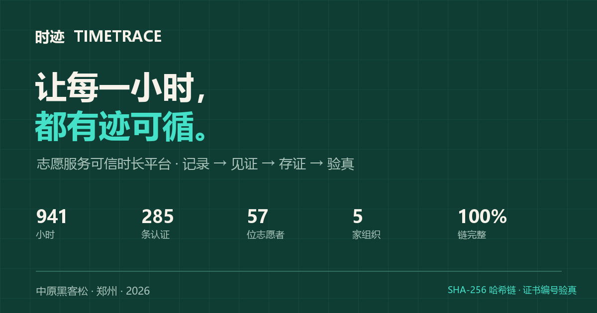

# 时迹 TimeTrace

把每一次志愿服务，变成可验证、可携带、可互认的可信凭证。

中原黑客松 2026 · 郑州

## 在线演示

- UUMit：<https://shiji-timetrace--salt.uua2a.com/>
- GitHub Pages：启用后补充

## 它解决什么问题

高校青协、社区、博物馆、红十字会等组织，记录散落在微信群、纸质签到和 Excel；证明靠盖章，无法核验；时长不能跨组织带走。志愿者成了自己经历的“举证者”。

时迹把流程做成：

> 一句话记录 → 组织审核 → SHA-256 哈希链存证 → 证书 → 编号/扫码验真 → 数据大屏

## 功能

- 志愿者端：一句话补录、风险自检、项目报名、证书、时长账本、年度报告
- 组织审核台：待审队列、高风险优先、批量通过、成员/项目/数据看板
- 可信证书：组织印章、证书编号、A4 打印/PDF；HTTPS 部署后支持微信扫码打开证书
- 公开验真：输入证书编号查看脱敏记录与哈希链校验结果
- 数据大屏：城市志愿数据实时视图
- 单文件、零后端、可离线演示；桌面全屏与手机自适应

## 技术栈

- 单文件 HTML / CSS / JavaScript，无构建依赖
- localStorage 本地优先
- SHA-256 哈希链（`prevHash` + `hash`），证书编号 `SJ-YYYY-NNNNNN`
- 二维码（qrcode-generator，内联）
- 可选 Node API：`node:http` + JSON 文件 + `scrypt` + HMAC 令牌

## 本地运行

直接双击 `index.html`，或：

```bash
python -m http.server 8080
# http://127.0.0.1:8080/index.html
```

## 演示账号

| 角色 | 邮箱 | 密码 |
| --- | --- | --- |
| 志愿者（林知夏） | `lin@shiji.cn` | `123456` |
| 组织（志愿者协会 / 周明远） | `zhou@shiji.cn` | `123456` |
| 组织（经三路社区 / 王春梅） | `wang@shiji.cn` | `123456` |
| 组织（河南博物院 / 李静） | `li@shiji.cn` | `123456` |
| 组织（绿城环保 / 赵敏） | `zhao@shiji.cn` | `123456` |
| 组织（金水红会 / 孙浩然） | `sun@shiji.cn` | `123456` |

组织端与志愿者端为独立登录态。

## 演示数据

941 小时 · 285 条认证 · 57 位志愿者 · 5 家组织 · 100% 链完整。演示数据均为虚构样例。

## 边界

哈希链证明“认证后未被改”，不证明“服务一定发生”；真实性靠组织见证、照片、见证人和风控。正式版接服务端组织签名、实名/组织 KYC、可信时间戳或联盟链锚定，避免客户端伪造。

## 目录

```text
index.html      # 完整单文件应用
cover.png       # 作品封面
提交文案.md      # 作品提交信息
```
